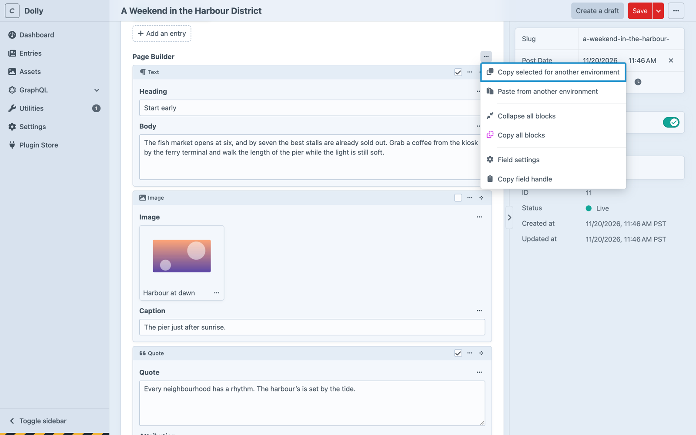

# Dolly
## Plugin for Craft CMS 5.x

Copy entries and Matrix or Neo blocks from one environment to another, such as from staging to production. The environments only need to share project config; they don’t need a connection to each other.

1. **Copy** content in the Source environment. Dolly exports it as a **Payload**, text you can copy or download as a `.dolly` file.
2. **Paste** it in the Target environment, into a Matrix or Neo field or into **Utilities > Dolly** for entries.
3. **Check the Preview** to see what will happen, then import. New entries arrive disabled, and overwrites and block pastes go into drafts, so nothing goes live until you review it.

## Requirements

This plugin requires Craft CMS 5.0 or later, and PHP 8.2 or later. Copying and pasting blocks needs Craft 5.7 or later.

## Installation

### With DDEV

```bash
ddev composer require simplygoodwork/craft-dolly -w && ddev craft plugin/install dolly
```

### With Composer

Open your terminal and run the following commands:

```bash
# tell Composer to load the plugin
composer require simplygoodwork/craft-dolly

# tell Craft to install the plugin
./craft plugin/install dolly
```

### From the Plugin Store

Go to the Plugin Store in your project’s Control Panel and search for “Dolly”. Then press “Install”.

## Usage

To copy an entry, choose **Copy for another environment** in the entry editor’s action menu, or as a bulk action in the entry index. Then paste the Payload into **Utilities > Dolly** in the Target environment.


To copy blocks, select them and choose **Copy selected for another environment** in the field’s action menu. Then choose **Paste from another environment** in the same menu in the Target environment.



Users need Dolly’s **Export content** and **Import content** permissions. See [Permissions](docs/configuration.md#permissions).

## Documentation

- [Copy and import entries](docs/copy-and-import-entries.md)
- [Copy and paste Matrix and Neo blocks](docs/blocks.md)
- [Check the Preview](docs/preview.md): import modes, related content, missing assets and schema Drift
- [Import log and queued Imports](docs/import-log.md)
- [Configuration and permissions](docs/configuration.md), including the optional Shared key for encrypted Payloads
- [Command line](docs/command-line.md)
- [Supported field types](docs/field-types.md), including version notes for Hyper, Formie and CKEditor
- [What Dolly doesn’t do](docs/limitations.md)
- [Extending Dolly](docs/developers.md): field adapters, element types and Dynamic Fields
- [Testing](docs/testing.md)

---

Brought to you by [Good Work](https://simplygoodwork.com).
