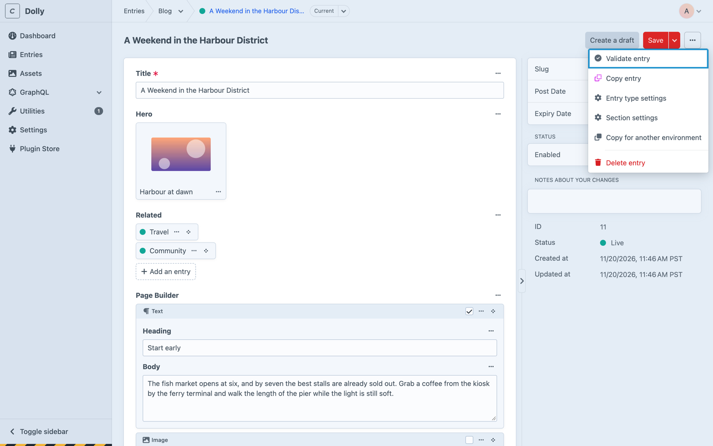
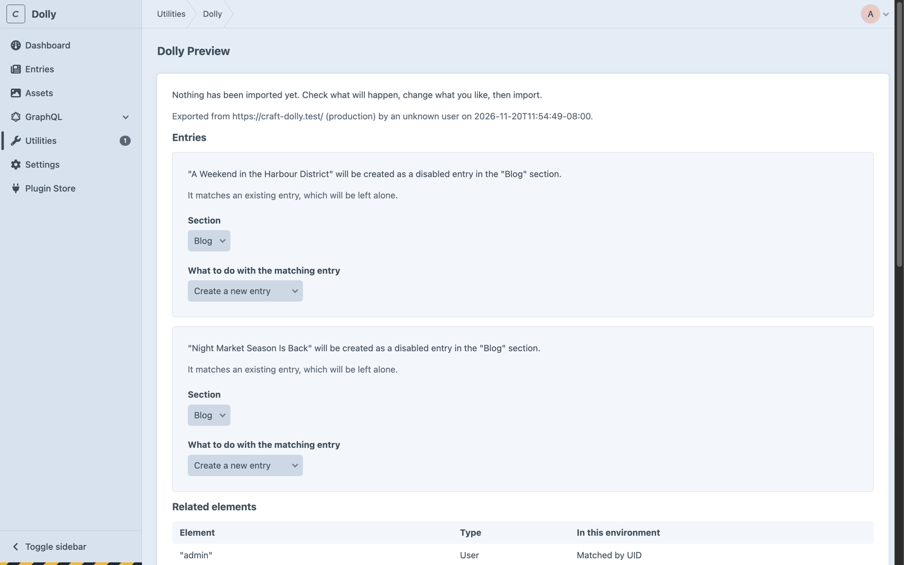

# Dolly

Dolly is a Craft CMS 5 plugin for site editors and developers who need to copy content between environments, such as staging and production. You can move whole entries or selected Matrix and Neo blocks between sites that share project config. The environments do not need a connection to each other.

**How it works**

1. **Copy in the Source environment.** Choose the content you want to move. Dolly exports it as a **Payload**: portable, version-tagged text you can copy or download as a `.dolly` file.
2. **Paste in the Target environment.** This is the environment receiving your content. Paste blocks into a field, or use **Utilities > Dolly** for entries. Dolly shows a **Preview**: a report of what will happen before it imports anything.
3. **Check the Preview, then import.** Review the choices and warnings. Click **Import** for entries or **Paste** for blocks. This applies the Payload to the Target environment and is called an **Import**.

## Contents

- [Requirements](#requirements)
- [Installation](#installation)
- [Copy an entry](#copy-an-entry)
- [Copy and paste Matrix and Neo blocks](#copy-and-paste-matrix-and-neo-blocks)
  - [Copy blocks](#copy-blocks)
  - [Paste blocks](#paste-blocks)
  - [Which fields accept the blocks?](#which-fields-accept-the-blocks)
- [Import entries in the Dolly utility](#import-entries-in-the-dolly-utility)
- [Check the Preview](#check-the-preview)
  - [Choose what happens to each entry](#choose-what-happens-to-each-entry)
  - [Resolve related content](#resolve-related-content)
  - [Bring in missing assets](#bring-in-missing-assets)
  - [Review changes to fields and settings](#review-changes-to-fields-and-settings)
- [Check the Import log](#check-the-import-log)
- [Large Imports in the queue](#large-imports-in-the-queue)
- [Set a Shared key](#set-a-shared-key)
- [Permissions](#permissions)
- [Command line](#command-line)
- [Supported field types](#supported-field-types)
- [What Dolly doesn’t do](#what-dolly-doesnt-do)
- [For developers](#for-developers)
  - [Register a field adapter](#register-a-field-adapter)
  - [Register an element type](#register-an-element-type)
  - [Configure Dynamic Fields](#configure-dynamic-fields)
  - [Use the core service for block pastes and queues](#use-the-core-service-for-block-pastes-and-queues)
  - [Run tests](#run-tests)
  - [Test other Craft and plugin versions](#test-other-craft-and-plugin-versions)
  - [Build schema in tests](#build-schema-in-tests)

## Requirements

This plugin requires Craft CMS 5.0.0 or later, and PHP 8.2 or later.

A few features need a newer Craft, and turn themselves off on older versions:

- Copying and pasting Matrix and Neo blocks needs Craft 5.7 or later, which adds the field action menus they live in. Copying whole entries works on every version.
- The Link (Craft 5.3), Range (5.5), JSON and Button Group (5.7) fields only exist from those versions, so Dolly only moves them where Craft has them.

Some plugin releases allow Craft 5.0 but don't work with it, or with Dolly:

- Hyper 2.3.1 and later use a class Craft 5.8 added, so a site on Craft 5.0–5.7 needs Hyper 2.3.0 or earlier.
- Formie 3.0.22–3.1.0 use an element query parameter Craft added in 5.2, so a site on Craft 5.0 or 5.1 needs Formie 3.1.1 or later. Before 3.0.22, forms' UIDs are out of sync, so Dolly matches forms only by their handle.
- CKEditor 4.0.0–4.0.3 replace nested entries with their rendered HTML whenever an entry is saved outside the control panel (Craft's `resave` commands included), so Dolly skips CKEditor fields on those versions, with a warning in the Preview. Update to CKEditor 4.0.4 or later.

## Installation

You can install Dolly from the Plugin Store or with Composer.

### From the Plugin Store

Go to the Plugin Store in your project’s control panel and search for “Dolly”. Then press “Install”.

### With Composer

Open your terminal and run the following commands:

```bash
# go to the project directory
cd /path/to/my-project.test

# tell Composer to load the plugin
composer require simplygoodwork/craft-dolly

# tell Craft to install the plugin
./craft plugin/install dolly
```

## Copy an entry

You need the **Export content** permission and permission to view the entry.

1. Open the entry in the Source environment.
2. Open the entry editor’s action menu and choose **Copy for another environment**.
3. Wait for the confirmation, then take the Payload to the Target environment.



Dolly exports what you see in the editor. It saves unsaved changes to your draft first, whether you are editing a provisional draft or a named draft. It exports that draft’s content as the entry it belongs to. An unpublished new entry is exported as a new entry. Only sites you can edit are included in the Payload.

You can also select several entries in the entry index and use **Copy for another environment** as a bulk action. This exports the selected canonical entries in one Payload. Each selected entry is a **Root element**: content you explicitly chose to export. Drafts and revisions are not offered in the index.

The action is separate from Craft’s own **Copy** action. Craft’s action is unchanged. You cannot export a revision, a nested entry on its own, or another user’s provisional draft.

### If Dolly offers a file instead

The Payload normally goes to your clipboard. If it is larger than `clipboardLimit` bytes, or your browser blocks copying, the confirmation notice offers a button to download a `.dolly` file instead. You can upload that file in the Dolly utility or a block paste modal.

The default `clipboardLimit` is 100,000 bytes. You can change it in `config/dolly.php`.

## Copy and paste Matrix and Neo blocks

Block copying and pasting needs Craft 5.7 or later. You need **Export content** to copy and **Import content** to paste.

### Copy blocks

1. Open the entry in the Source environment.
2. Select one or more blocks with their checkboxes.
3. Choose **Copy selected for another environment** in the field’s action menu.

You can also choose **Copy for another environment** in a block’s menu. If that block is selected, Dolly copies every selected block. Dolly checks the page’s block IDs against your draft. If the page is out of date, it refuses the action so you do not copy the wrong block.


You can copy Matrix blocks in cards or inline view, and Neo blocks. A Neo block includes its nested child blocks. The blocks you select are the Payload’s Root elements. Dolly saves unsaved changes to your draft first, then copies the Payload to the clipboard or offers a file, just as it does for an entry.

### Paste blocks

1. Open the entry in the Target environment.
2. Choose **Paste from another environment** in a Matrix or Neo field’s action menu.
3. If Dolly can read a Payload from your clipboard, it opens the Preview straight away. Otherwise, paste the text or upload a `.dolly` file in the modal.
4. Review the blocks, warnings and choices for related content, then click **Paste**.
5. Save or apply your draft as usual.


Dolly adds the blocks to the end of the field in your draft. It creates a provisional draft if you do not have one. The live entry stays as it is. The paste is recorded in the [Import log](#check-the-import-log), Dolly’s permanent record of Imports.

**Opening the Preview saves what is on screen to your draft first, even if you cancel.** This can create a provisional draft. Craft’s own “add block” action works this way too. Dolly needs the draft’s current blocks and sites to build an accurate Preview.

Only the draft’s own site is written, as in Craft’s editor. Craft propagates blocks to other sites according to the field’s propagation method. Dolly never saves a site you cannot edit. If you paste more than the field’s maximum number of blocks, the Preview warns you. The draft still saves; Craft checks the maximum when you apply the draft.

### Which fields accept the blocks?

| Payload | Where you can paste it |
| --- | --- |
| Matrix blocks | Any Matrix field that allows their entry types. Blocks of other types are skipped with a warning. |
| Neo blocks | The same Neo field they came from, matched by UID (Craft’s unique identifier). Its block types and hierarchy belong to that field. Another Neo field refuses the Payload with a message. |

The utility and `dolly/import` accept entry Payloads, not block Payloads. A field accepts block Payloads, not entry Payloads.

## Import entries in the Dolly utility

You need the **Import content** permission and the Craft permissions for the content you will create or edit. See [Permissions](#permissions).

1. In the Target environment, go to **Utilities > Dolly**.
2. Paste the Payload into **Payload text**, or upload a `.dolly` file.
3. Click **Preview**.
4. Check the entry choices, related elements and warnings described below.
5. Click **Import**. Dolly opens the Import log entry with the results or queue progress.



New entries arrive **disabled**. If you choose to overwrite a matching entry, Dolly creates a **draft** on it. Review the imported content before you enable an entry or apply a draft.

## Check the Preview

The Preview shows what each Root element will become, how related content matches, what will be skipped, and which required fields will be left empty. It also shows where the Payload came from and who exported it.

The Preview refreshes as you change choices, select replacements or upload files. The **Import** or **Paste** button is disabled while it refreshes. Use **Update Preview** to re-check the current site with your choices, for example if content or settings changed since you opened it. If the plan has changed when you try to import, Dolly shows the Preview again so you can review it first.

If the Import log already contains this Payload, the Preview tells you who imported it and when. This warning does not stop you importing it again.

### Choose what happens to each entry

The **Target section** is the section receiving a Root entry. You can keep the Payload’s section or choose another section that allows its entry type.

An **Import mode** controls what happens when a Root entry matches an existing entry in that section. Dolly matches by UID first, then by identifying attributes called a **Natural key**. For entries, this is the section and slug, plus the parent slug path in a Structure.

**Owned content** means blocks and nested entries that belong to an element, including CKEditor nested entries. It travels with full content, recursively. Other related content travels as **References**: pointers that identify it without carrying its full content.

| Choice | What happens |
| --- | --- |
| **Create a new entry** | The default. Dolly creates a disabled entry and leaves any matching entry alone. If the source UID is already used, the new entry gets a fresh UID, as does any of its Owned content. |
| **Overwrite it (on a draft)** | Dolly creates a draft on the matched entry. It applies only fields present in the Payload that are not skipped. A Matrix or Neo field’s blocks are replaced as a whole. The matched live entry is unchanged; its enabled state and authors are kept. |

The Preview shows the matching entry, the available modes, the chosen mode and the Target section. If overwrite is unavailable, it explains why. Changing the Target section resets the mode to creating a new entry, because the matching entry may change.

### Resolve related content

A **Reference** points to related content without carrying its full content. Dolly records a **Resolution** when it matches that Reference to an element in the Target environment. The Preview shows which rule matched it.

Dolly tries the UID first, then the Natural key:

| Related content | Natural key |
| --- | --- |
| Entries | Section + slug, plus parent slug path in Structures |
| Categories | Group + slug, plus parent path |
| Tags | Group + title |
| Users, including entry authors | Email, then username |
| Assets | Volume + folder path + filename |
| Formie forms | Form handle |
| Solspace Calendar events | Calendar + slug; see [Form and event relations](#form-and-event-relations) |

If a Natural key matches several elements, Dolly matches none of them. This leaves an **Unresolved reference**: related content Dolly cannot identify in the Target environment.

For an Unresolved reference, the Preview offers the choices that apply:

| Choice | What it means |
| --- | --- |
| Skip | The default. Leave the Reference out and report it. |
| Create a Stub | Create a disabled, minimal element using only the Reference’s identifying information. A **Stub** preserves the relation; it is not a full copy of the source content. |
| Choose a replacement | Relate an existing element in the Target environment instead. |
| Fetch | For an unresolved asset, download its file from the source URL during Import and create the asset in the Target environment. |
| Upload | For an unresolved asset, create the asset from a file you upload in the Preview instead. |

Stubs are created in their original section or group, in its first site, at the top level of a Structure. Users are never Stubbed. An unresolved author is replaced by the user running the Import; unresolved users in user fields are skipped. An entry being imported as a Root element in the same Payload is never Stubbed, because that would duplicate it. Assets, Formie forms and Calendar events are not Stubbed either.

A choice that cannot be carried out refuses the whole Payload before anything is written. The Preview explains the problem so you can change the choice.

### Bring in missing assets

**Fetch** and **Upload** create the asset with the Reference’s title, alt text, focal point and custom field values. Choose its own volume, or another volume and folder path in the Preview.

Fetching needs a usable source URL. It fails for private volumes and sources behind basic auth; upload the file instead. Until you pick a replacement or an upload file, that Reference is skipped.

### Review changes to fields and settings

A **Schema reference** identifies a project-config item, such as a field, entry type, section or site, by UID. **Drift** describes whether that item still matches the Source environment. Dolly compares a **Fingerprint**, a hash of its config recorded at Export, with the Target environment’s config.

| State | What it means |
| --- | --- |
| Matched | The UID and Fingerprint match. |
| Drifted | The UID matches, but the settings changed. Field values are imported with a warning. |
| Type changed | The field has changed type. Its value is skipped with a warning. |
| Missing | The item is absent. Missing field values are skipped with a warning. A Root element with a missing section is not imported; other Root elements can still be imported. You can choose an available Target section that allows its entry type. |

Check the Preview’s **What happens** column and warnings before you continue.

## Check the Import log

The **Import log** is the permanent record of Imports in the Target environment. Find it below the Payload form in **Utilities > Dolly**, newest first. Click an Import number to see its details.

The log records who ran the Import and when, the Payload’s identity and Source environment, the choices made for Unresolved references, and the result for each Root element. The detail page links to created entries or drafts and lists warnings, errors, Stubs and assets created by Fetch or Upload. Block pastes and command-line Imports are recorded too.

A Preview alone does not create an Import log entry.

## Large Imports in the queue

An entry Import from the Dolly utility runs as a **Queued Import** when it has more than 10 Root elements or any asset Fetch from a source URL. This means a Craft queue job runs the Import instead of the web request.

The Import log entry appears at once. Its detail page reloads itself while the Import is unfinished.

| Status | What it means |
| --- | --- |
| Queued | Waiting for the job to start. |
| In progress | The job is importing Root elements. Each says “not imported yet” until it has a result. |
| Completed | Every Root element has a result. An individual failure stays in the results and does not stop the others; each Root element has its own transaction. |
| Failed | The job could not run, or its worker died. See the causes below. |

An Import is marked Failed if:

- The user who queued it no longer exists or no longer has **Import content** permission.
- The Payload is refused or the job could not be added to the queue.
- The worker dies. An Import in progress for over an hour without a result is shown as failed.
- The Target environment changed after the Preview, so the Import would no longer do what you reviewed. In this case nothing is imported. Preview the Payload again before importing it.

A job that has started is never retried, because some Root elements may already have been imported.

The job keeps the Payload text, your exact Preview choices and a fingerprint of the plan you reviewed. It runs as the user who queued it.

Files you upload for unresolved assets stay in your staging directory until the job uses them, then are discarded. **The queue worker must share Craft’s runtime temp path with the web server.** Staged files are purged after 24 hours, when you next upload a file. A queue more than a day behind can therefore fail an Import that needs an uploaded asset.

Without a [Shared key](#set-a-shared-key), an optional secret for encrypting and authenticating Payloads, the Payload text stays in Craft’s `queue` table and is visible in Queue Manager job details until the job runs. With a Shared key, the stored text is encrypted.

`dolly/import` always runs inline, regardless of size. Block pastes also run immediately, regardless of size or asset Fetches, so the blocks are in your draft when the paste finishes.

## Set a Shared key

A **Shared key** is an optional secret that encrypts and authenticates every Payload. Use the same secret in every environment.

1. Go to **Settings > Plugins > Dolly**.
2. Set **Shared key** to an environment variable reference, such as `$DOLLY_SHARED_KEY`.
3. Give that environment variable the same secret in every environment.

The settings form only accepts an environment variable reference. The secret itself never reaches project config. A `sharedKey` in `config/dolly.php` is not checked this way, so use an environment variable reference there too.

With a Shared key, every Export produces a `dolly:v1e:` Payload using Craft’s authenticated encryption. Import accepts only Payloads encrypted with that same key. It refuses unencrypted Payloads, Payloads encrypted with another key, and Payloads changed after Export.

Without a Shared key, an encrypted Payload is refused. If your setting names an environment variable that is not set, both Export and Import fail. Dolly does not fall back to unencrypted Payloads.

## Permissions

Assign Dolly’s permissions to the users or groups who need them:

| Permission | Allows you to |
| --- | --- |
| **Export content** (`dolly-exportContent`) | Copy entries and selected blocks for another environment. Both the editor and index actions check that you can view the entries. |
| **Import content** (`dolly-importContent`) | Preview and import entries, paste blocks, and view the Import log. |

For **Utilities > Dolly**, you also need Craft’s permission to access that utility. Dolly’s permissions work alongside Craft’s content permissions. You need permission to create entries in the Target section, create drafts on an entry you overwrite, or edit the draft receiving pasted blocks. Replacements must be elements you can view. Fetching or uploading assets needs permission to save assets in the chosen volume, and to create folders if the folder does not exist.

## Command line

Run these commands from your Craft project directory.

### Export entries

Pass one entry ID or comma-separated IDs. Dolly writes the Payload to stdout unless you choose a file:

```bash
php craft dolly/export 123
php craft dolly/export 123,456 --output=page.dolly
```

### Preview and import entries

Pass Payload text as an argument, read it from a file, or use stdin. `--user` is required: give the email of the active user who will run the Import. New entries are disabled. Unresolved references are skipped and listed by default. The Import log records the Import against that user.

```bash
php craft dolly/import 'dolly:v1:H4sI…' --user=editor@example.com
php craft dolly/import --file=page.dolly --user=editor@example.com
php craft dolly/import --user=editor@example.com < page.dolly
```

Add `--dry-run` to print the Preview without writing anything, including an Import log entry. It lists changed fields, entry types, sections and sites, skipped values and required fields that will be left empty.

```bash
php craft dolly/import --file=page.dolly --user=editor@example.com --dry-run
```

### Choose how to handle Unresolved references

Use `--stub` for a comma-separated list of Reference UIDs to create as disabled Stubs. Use `--replace` for `uid=elementId` pairs, or `--choices` for a JSON file of choices. The [Preview rules](#resolve-related-content) apply here too. Unresolved authors use the `--user` identity; unresolved user-field values are skipped.

Replace `<uid>` in these examples with the relevant UID before running the command.

```bash
php craft dolly/import --file=page.dolly --user=editor@example.com --stub=<uid>,<uid> --replace=<uid>=123
php craft dolly/import --file=page.dolly --user=editor@example.com --choices=choices.json   # {"<uid>": "stub", "<uid>": 123}
```

For assets, `--fetch` takes comma-separated UIDs to Fetch into their own volume and folder. In a `--choices` JSON file, a Reference UID can map to `"skip"`, `"stub"`, `"fetch"` or a replacement element ID. Use an object to choose a Fetch volume and folder, or to Upload from a local file:

```json
{
    "<asset-uid-to-fetch>": {"choice": "fetch", "volume": "photos", "folder": "blog/2026"},
    "<asset-uid-to-upload>": {"choice": "upload", "path": "/path/to/photo.png"}
}
```

`--stub`, `--replace` and `--fetch` override the choices file.

### Overwrite or choose a Target section

Use `--overwrite` with comma-separated Root element UIDs, or `'*'` for every Root element that matches an entry. Non-matching Root elements are created as new entries. Overwrite creates a draft, as described in [Choose what happens to each entry](#choose-what-happens-to-each-entry).

Use `--section` with a section handle for all Root entries, or comma-separated `uid=handle` pairs for individual Root entries. The section must allow the entry type or Dolly refuses the Payload.

```bash
php craft dolly/import --file=page.dolly --user=editor@example.com --overwrite='*'
php craft dolly/import --file=page.dolly --user=editor@example.com --overwrite=<uid> --section=<uid>=blog
```

The result reports “Created a draft #X on entry #Y” for each overwrite. With `--dry-run`, it prints each Root element’s match, available modes, chosen mode and Target section. Repeated-Payload warnings, Reference matching and Drift work as described in [Check the Preview](#check-the-preview).

## Supported field types

A **Field adapter** translates a field value for Export and Import, including any IDs inside it. Dolly provides adapters for these fields. Third-party adapters are registered only when their plugin is installed. Core fields added after Craft 5.0 are available only on Craft versions that include them; see [Requirements](#requirements).

An **Embedded reference** is an element ID inside a field value, such as a rich text reference tag or link target, rather than a normal relation. Supported adapters translate these too.

| Fields | What moves |
| --- | --- |
| Plain Text, Number, Range, Lightswitch, Color, Email, Table, JSON, Country, Icon | Their values. |
| Dropdown, Radio Buttons, Checkboxes, Multi-select, Button Group | Selected options. Values no longer offered by the Target field are dropped with a Preview warning. |
| Date, Time | Their values. A Date field that shows its time zone keeps its named time zone. |
| Money | Amount and currency. If the Target field uses another currency, the Preview warns that the amount in minor units may change magnitude. |
| Entries, Categories, Tags, Users, Assets | References matched in the Target environment. |
| Matrix, Neo | Blocks and their Owned content. |
| CKEditor | Rich text, Embedded references and nested entries. Supported from CKEditor 4.0.4, with the same behavior across supported versions. |
| Link, Hyper, Linkit | Links and their References. See the notes below. |
| SEOmatic SEO Settings, Ether SEO | Entry SEO values and image References. See the notes below. |
| Colour Swatches | The selected swatch label, checked against the Target palette. |
| Retour short link | The URL, checked for redirect collisions. |
| SimpleMap (Maps) | Location data; the Target environment creates its own record. |
| Preparse | No stored value; the Target environment recalculates it on save. |
| Position, Code | Their values, including the Code field’s language. |
| TableMaker | Columns, rows, caption and translated References in rich text cells. |
| Icon Picker | The selected icon and its icon set. |
| Formie Forms, Solspace Calendar Events | References to forms or events already in the Target environment. |
| LJ Dynamic Fields: Dropdown, Radio Buttons, Checkboxes, Multi-select | IDs translated according to your [Dynamic Fields config](#configure-dynamic-fields). Undeclared fields use the fallback described below. |

### Links

Hyper 2 and 3 work the same way, including fields using Hyper 3’s shared link type configs. A link matches its type in the Target field by handle. The Preview reports Drift for each field’s link types.

Linkit identifies link types by handle (`entry`, `url`, `email`…), never by class. URL, email, phone and social links keep their values, custom text and target. Entry, asset, category and user links travel as References. They can be matched, Stubbed, replaced, Fetched or cleared with a warning, as appropriate for their type.

Commerce product links and link types the Target Linkit field does not enable are cleared with a warning. This happens before Dolly resolves any Reference inside the link.

### SEO fields

**SEOmatic SEO Settings** keeps its values, including Twig and object templates. SEO, Facebook and Twitter images are asset References: matched, Fetched or cleared with a warning. Only images are accepted.

Handwritten Twig containing asset IDs is not translated. Images in site-level identity and creator settings also move untranslated. Dolly never reads or writes section-level SEOmatic meta bundles. If a setting reads a field the Target entry does not have, it is imported with a warning.

**Ether SEO** keeps the title, description, keywords, score, social titles and descriptions, robots and canonical URL. Twitter and Facebook images are asset References: matched, Fetched or cleared with a warning. Only images are accepted.

Ether fills empty robots from the environment’s global default whenever it loads a value. Dolly therefore exports the robots and social texts stored in the entry’s database record. Robots the entry does not store use the Target environment’s defaults. Social handles—the site’s Twitter handle and Facebook app ID—come from each environment’s settings and do not move. The canonical URL is not translated and may still point at the Source environment.

### Colour Swatches

The field finds a swatch by label whenever it saves, using its own colours or a palette from `config/colour-swatches.php`. The Target palette determines the colour and CSS class.

A label missing from the Target palette is dropped with a Preview warning. The field then displays its default swatch, if one is marked as default. Depending on the Craft version and whether the entry is new, it may also save its default setting or a random colour.

### Retour short links

The URL moves as it is. Retour creates the redirect when the imported entry is saved, or when an overwrite draft is applied.

Dolly skips a short link with a Preview warning if its URL already belongs to another redirect in the Target environment. That could be another element’s short link or a manual redirect. The entry’s own short link is allowed, so overwriting an entry with its own short link works.

A short link in a Matrix or Neo block belongs to the top entry that owns it. Retour ties the redirect to that entry. Overwriting that entry keeps the short link. So does pasting into a draft of that entry or one of its nested entries. Pasting into another entry skips it.

If two Root elements in a Payload use the same short link, the later one’s short link is skipped with a Preview warning. A skipped short link leaves a new entry without one. An overwrite draft keeps the entry’s existing short link.

### Maps and calculated values

SimpleMap moves latitude, longitude, zoom, address and its parts, and what3words. It leaves out SimpleMap’s record, owner, site and field IDs. SimpleMap writes its own record when it saves the new entry or overwrite draft, so location searching and sorting work in the Target environment.

Preparse values are not carried in the Payload. Preparse renders them from the field’s template each time an element saves. The Target environment recalculates them from its own content and template. The Preview notes this for each Preparse field.

### Icon Picker

The selected icon travels with its icon set. Dolly matches the set by UID, stored by Icon Picker 3.1 and later. If the value has no UID, it uses the set’s handle.

If the set is missing or the Target field does not offer it, the icon is dropped with a Preview warning. If an SVG file is missing from the Target environment’s icon sets folder, the value is imported with a warning. It appears once you deploy the file. The folder defaults to `@webroot/icon-picker/` and is not in project config.

Values saved by Icon Picker 3.0.0 do not name their icon set and move as they are.

### TableMaker rich text

TableMaker moves columns, rows and caption as they are, except for entry, category and asset links in rich text cells (TableMaker 5.1.1+). These links store an element reference as a URL fragment, such as `<a href="https://…/page#entry:12@1:url">`. A cell can also contain reference tags.

Both are Embedded references. Their element IDs and sites travel as UIDs and resolve like other References. You can skip, replace or Stub them. If a link’s element or site does not resolve, Dolly removes the link and keeps its text, with a Preview warning. An unresolved reference tag becomes its fallback text, as in CKEditor.

Plain text cells remain text. TableMaker does not resolve reference tags in them, so neither does Dolly.

### Form and event relations

**Formie forms** are not in project config, so their UIDs usually differ between environments. Dolly matches by UID, then handle. Before Formie 3.0.22, forms’ UIDs were out of sync, so those forms match only by handle.

You can skip an unresolved form or replace it with another form. Forms are never Stubbed. Replacements are not limited to a form template (Formie 3) or form group (Formie 4).

Formie 4 limits control panel form queries to forms you can view in Formie. Its Forms field does not, and Dolly follows the field’s behavior. A control panel Import can relate a form you cannot view in Formie, just as editing the field can. A form you choose as a replacement must still be one you can view.

**Solspace Calendar events** are registered as `calendarEvent` when Calendar is installed and enabled. Event relations match by UID, then calendar and slug. The Payload uses the slug from the site you exported the entry from. It can match an event in any site, because an event’s slug can differ per site.

A replacement event must be in the same calendar. Events are never Stubbed. Skip the Reference or choose a replacement.

### Other field types

A field without an adapter falls back to Craft’s `serializeValue()` and `normalizeValue()`. The Preview warns that the value will be imported as it is and may contain environment-specific IDs Dolly cannot translate. A field that cannot be serialized is left out of the Payload.

Fields with nested content but no adapter, such as Content Block and Addresses, are skipped with a warning. Raw serialization would carry the source IDs of the elements inside them without translation.

## What Dolly doesn’t do

- **Move project config.** The environments need to share it. Dolly reports Drift so you can review differences.
- **Copy all related content automatically.** Full content travels only for Root elements and their Owned content. Other related elements travel as References. Select each entry you want to move as a Root element. A Stub carries only identifying information.
- **Publish imported entries for you.** New entries are disabled. Overwrites use drafts; block pastes edit drafts.
- **Import across Craft major versions.** A Payload from another Craft major is refused.
- **Translate unsupported fields or arbitrary IDs.** Check the fallback warnings and the field-specific caveats above.
- **Accept invalid Payloads.** Dolly checks the envelope before planning. An unknown format version, malformed section, or Root element or Reference with an unregistered element type refuses the Payload. Built-in types are entries, categories, tags, users and assets, plus Formie forms and Calendar events when their plugins are installed and enabled. See [Register an element type](#register-an-element-type).
- **Accept unlimited Payload sizes.** The default `maxPayloadSize` is 8 MB, for both Payload text and decompressed content. Dolly stops decompressing at the limit, so a small Payload that expands to gigabytes cannot exhaust memory.

You can raise the size limit in `config/dolly.php`:

```php
return [
    'maxPayloadSize' => 32 * 1024 * 1024,
];
```

## For developers

### Register a field adapter

Register an adapter for your field class with `FieldAdapterRegistry::EVENT_REGISTER_ADAPTERS`. Implement `simplygoodwork\craftdolly\fields\FieldAdapter`:

- `export()` returns a JSON-safe value for the Payload.
- `import()` returns a value for `setFieldValue()` in the Target environment.

Adapters match the field’s exact class. Your registered adapter replaces the fallback and any adapter Dolly ships for that class.

```php
use simplygoodwork\craftdolly\events\RegisterFieldAdaptersEvent;
use simplygoodwork\craftdolly\fields\FieldAdapterRegistry;
use yii\base\Event;

Event::on(
    FieldAdapterRegistry::class,
    FieldAdapterRegistry::EVENT_REGISTER_ADAPTERS,
    function(RegisterFieldAdaptersEvent $event) {
        $event->adapters[MyField::class] = new MyFieldAdapter();
    },
);
```

Register the handler while your plugin initializes, before Dolly is first used in the request. The registry is built once; later registrations are ignored. Every value must implement `FieldAdapter`. Otherwise, building the registry throws an `InvalidConfigException`.

During `export()`, `$context->element()` gives you the element holding the value. Use it if the field’s `serializeValue()` needs the owner. Import has no Target element while it plans, so `import()` has none.

Use `ExportContext::addReference()` and `ImportContext::resolveReference()` for elements your value points to. Use `$context->plan->warn()` to report anything the Import drops.

### Register an element type

Dolly’s registered element types are entries, categories, tags, users and assets. It also registers Formie forms (`formieForm`) and Solspace Calendar events (`calendarEvent`) when their plugins are installed and enabled.

Register your own type with `ElementTypeRegistry::EVENT_REGISTER_ELEMENT_TYPES`. Give it a short name that the Payload carries instead of its class ([ADR-0004](docs/adr/0004-registry-of-element-types.md)). Relation fields for that type then work without their own Field adapter. So do Link and Hyper links to it. References match by UID, then by the type’s Natural key.

Extend `simplygoodwork\craftdolly\references\ElementTypeDefinition`. Only three methods are required:

- `elementClass()`: the element class.
- `naturalKey()`: the identifying attributes carried by the Reference, in JSON-safe form.
- `find()`: the ID of the single element matching those attributes, or null.

By default, References of your type are not limited to an element source and cannot be Stubbed. Override `sourceFor()`, `isInSource()` and `sourceName()` to limit replacements to the Reference’s own source. Override `canBeStubbed()` and `stub()` to allow Stubs.

Override `query()` if the type’s own element query has limits that do not apply to relations. Dolly uses this query to match References by UID and load matched or replacement elements.

```php
use simplygoodwork\craftdolly\events\RegisterElementTypesEvent;
use simplygoodwork\craftdolly\references\ElementTypeRegistry;
use yii\base\Event;

Event::on(
    ElementTypeRegistry::class,
    ElementTypeRegistry::EVENT_REGISTER_ELEMENT_TYPES,
    function(RegisterElementTypesEvent $event) {
        $event->types['widget'] = new WidgetDefinition();
    },
);
```

Register the type under the same short name in every environment. An unregistered name refuses the Payload. Names must contain only letters and digits, starting with a letter.

The short name is used only in the Payload. Messages and the Preview use the class’s `lowerDisplayName()`, such as “form” or “event”. Imported reference tags use its `refHandle()` in the Target environment.

As with adapters, register the handler before Dolly is first used in the request. An `InvalidConfigException` is thrown for a definition that does not extend `ElementTypeDefinition`, an invalid or reserved name, or a class already registered under another name.

See `tests/_support/WidgetDefinition.php` for a complete example.

### Configure Dynamic Fields

LJ Dynamic Fields’ Dropdown, Radio Buttons, Checkboxes and Multi-select fields render options from Twig templates. Their values are often IDs that mean something else in another environment.

In `config/dolly.php`, declare what each field’s values identify. Use the field’s own handle, even if a field layout overrides it:

```php
return [
    'dynamicFields' => [
        'sectionIDs' => 'section',
        'featuredEntry' => 'entry',
    ],
];
```

Choose a kind for each field:

- `section`, `entryType`, `categoryGroup`, `volume` or `site`: values travel as Schema references, with their Drift listed in the Preview.
- A registered element type’s short name, such as `entry`, `category`, `tag`, `user` or `asset`: values travel as References. They can be matched, replaced, Stubbed or Fetched as appropriate. You can use any [registered element type](#register-an-element-type).

On Import, each value becomes the ID of the same thing in the Target environment. A value that does not resolve, or was not an ID of that kind in the Source environment, is dropped with a warning. An unknown kind makes Export and Import fail with an `InvalidConfigException`.

Declare the field the same way in every environment. The Payload carries its declared kind. If the Target environment declares another kind, or only one environment declares the field, its values are skipped with a warning. This prevents Dolly from reading them as IDs of something else.

An empty selection is imported either way. An undeclared Dynamic field uses Craft’s serialization fallback, with its warning.

### Use the core service for block pastes and queues

For a block paste, pass a `BlockTarget` to the core service’s `import()` and `preview()`. It identifies the draft and one of its Matrix or Neo fields.

The core service’s `import()` only queues when called with `queue: true`, as the Dolly utility does. The CLI and block pastes run inline. Keeping block pastes inline is a product decision that departs from “any asset fetch” in the spec: the editor needs the blocks in its draft when the paste finishes.

### Run tests

The suite uses [Codeception](https://codeception.com) with Craft’s own test module (`craft\test\Craft`). It runs inside the DDEV project that hosts this plugin, against a dedicated `dolly_test` database. That database is wiped and Craft is reinstalled on every run, with Dolly installed. The dev database is never touched.

From the DDEV project root:

```bash
# once, to install the plugin's dev dependencies
ddev exec --dir /var/www/html/plugins/dolly composer install

# whole suite
ddev exec --dir /var/www/html/plugins/dolly composer test

# one file, or one test
ddev exec --dir /var/www/html/plugins/dolly vendor/bin/codecept run unit HarnessTest
ddev exec --dir /var/www/html/plugins/dolly vendor/bin/codecept run unit HarnessTest:testSavesAndReadsBackMatrixBlocks
```

The bootstrap creates the test database if it's missing. It connects to `db` as `root`/`root` by default. Override that with `DOLLY_TEST_DB_HOST`, `DOLLY_TEST_DB_PORT`, `DOLLY_TEST_DB_NAME`, `DOLLY_TEST_DB_USER` and `DOLLY_TEST_DB_PASSWORD`. The database name must contain `test`.

Each test runs in a transaction that is rolled back afterwards. Its schema and content do not carry over to the next test.

The suites use `tests/_support/CraftModule.php`. This is Craft’s test module with Craft 5.2.7’s rollback fix backported. Before 5.2.7, test transactions never began.

Before committing, run every check (phpstan, coding standards, the whole suite):

```bash
ddev exec --dir /var/www/html/plugins/dolly composer check
```

### Test other Craft and plugin versions

GitHub Actions (`.github/workflows/ci.yml`) runs `composer check` against each version set Dolly supports. `composer.lock` isn't committed, so each job resolves its own versions:

| Job | PHP | Craft | Hyper | CKEditor | Formie | Icon Picker |
|---|---|---|---|---|---|---|
| Lowest (`--prefer-lowest`) | 8.2 | 5.0.x | 2 | 4.0.4 | 3.1.1 | 3.0.0 |
| Craft 5.7 (first with block copy/paste) | 8.2 | 5.7.x | 2 | 4 | 3 | 3.0.x |
| Latest with Hyper 3 | 8.4 | latest | 3 | 5 | 4 | latest |
| Latest with Hyper 2 | 8.4 | latest | 2 | 5 | 3 | latest |

Every job installs Formie, so its tests run against Formie 3 or 4 as the table says.

To test another version set locally, copy the plugin to a scratch directory inside the DDEV web container. Resolve dependencies there to leave your own `vendor/` alone. For example, run the lowest job from the DDEV project root:

```bash
ddev exec bash -c '
  rm -rf /tmp/dolly-lowest && mkdir /tmp/dolly-lowest
  tar -C /var/www/html/plugins/dolly --exclude=./vendor --exclude=./.git --exclude=./composer.lock -cf - . | tar -xf - -C /tmp/dolly-lowest
  cd /tmp/dolly-lowest
  composer config audit.block-insecure false
  composer require --no-update "craftcms/cms:~5.0.0"
  composer require --dev --no-update "verbb/hyper:^2.0" "craftcms/ckeditor:~4.0.4" "verbb/formie:^3.1.1"
  php8.2 /usr/local/bin/composer update --prefer-lowest --no-interaction
  DOLLY_TEST_DB_NAME=dolly_test_lowest php8.2 -d display_errors=0 -d "error_reporting=E_ALL & ~E_DEPRECATED" vendor/bin/codecept run
'
```

Composer 2.9+ refuses versions with published security advisories. These include Craft 5.0.0 and many early 5.x releases, so the recipe sets `audit.block-insecure false`. Use a separate test database through `DOLLY_TEST_DB_NAME`; the suite wipes it. Change the constraints to test another job’s versions.

The `-d` options apply the error settings from CI’s production `php.ini`. DDEV’s PHP CLI displays deprecations. Some old Craft dependencies raise them on PHP 8.2 while Codeception starts, before the test bootstrap can buffer output. That output makes tests fail with “headers have already been sent”.

Use `simplygoodwork\craftdolly\tests\support\Requires` to skip tests for features a supported version does not have. Call it first in the test, or in `_before()` for a whole class:

```php
Requires::classes('The JSON field', \craft\fields\Json::class); // a field type added after Craft 5.0
Requires::craft('5.7.0', 'Block copy/paste');                     // behaviour that starts at a Craft version
Requires::package('verbb/hyper', '^3.0', 'Shared link type configs');
```

phpstan also checks each job’s versions. Guard code that uses an API available only in some versions with runtime checks such as `class_exists()`, `defined()` or `property_exists()`.

For older versions, the corresponding phpstan errors are ignored in `phpstan.neon`. Each ignore is scoped to its file and message, with `reportUnmatched: false`. Jobs whose versions provide the API still check it in full.

Console tests use `consoleCommand($command, $params, $ignoreStdOut)`. Pass `false` as the third argument whenever the test asserts `->stdout()`: with `true`, every stdout expectation is skipped and the test passes without checking the output.

### Build schema in tests

Use `simplygoodwork\craftdolly\tests\support\Schema`, in `tests/_support/Schema.php`, to build fields, entry types, sections and entries through Craft’s services. If a save fails, it throws with the validation errors, including errors on nested entries:

```php
$textBlock = Schema::blockType('textBlock', [Schema::plainText('body')]);
$page = Schema::entryType('page', [
    Schema::plainText('summary'),
    Schema::matrix('contentBlocks', [$textBlock]),
]);
$section = Schema::section('pages', [$page]);

$entry = Schema::entry($section, $page, [
    'title' => 'Hello',
    'summary' => 'A summary',
    'contentBlocks' => [
        'new1' => ['type' => 'textBlock', 'fields' => ['body' => 'First']],
    ],
]);
```

Use these helpers for related elements, sites and fields:

- `Schema::categoryGroup()`, `Schema::category()`, `Schema::tagGroup()`, `Schema::tag()` and `Schema::user()` build related elements.
- `Schema::site()` adds a site. Create sites before the sections that use them.
- `Schema::translate($element, $site, [...])` saves an element’s content in another site.
- `Schema::field(SomeField::class, 'handle', [...settings])` builds another field type.
- `Schema::required($field)` makes a field required when used in an entry type’s field list.

`Schema::hyper()` saves a Hyper field. Build its link types with `Schema::hyperLinkType(linkTypes\\Url::class, 'url', [...customFields])`. Use `Schema::changeHyperLinkTypes()` and `Schema::removeHyperLinkType()` to simulate link types changing in the Target environment. `Schema::withHyperLinkType()` registers an extra link type for a callback, as a plugin would.

On Hyper 3, `Schema::hyperLinkTypeConfig('navigation', [...linkTypes])` saves a shared link type config and returns its UID. Use that UID in `Schema::hyper('links', [], ['linkTypeConfig' => $uid])`, or use `'default'` for Hyper’s Default config. `Schema::changeHyperLinkTypeConfig()` changes a shared config’s link types. Guard these tests with `Requires::package('verbb/hyper', '^3.0', ...)`.

`Schema::linkit('cta', [models\\Entry::class, models\\Url::class])` saves a Linkit field with those link types enabled. `Schema::changeLinkitTypes()` changes them to simulate a different Target environment.

`Schema::withEtherSeoSettings(['robots' => ['noindex']], fn() => ...)` runs a callback with Ether SEO's global settings changed, to simulate an environment with different SEO defaults.

`Schema::withColourSwatchesSettings(['palettes' => ['Brand' => [...]]], fn() => ...)` runs a callback with Colour Swatches' config-file palettes changed, to simulate an environment whose `config/colour-swatches.php` differs.

`Schema::iconSet(SvgFolder::class, 'brand', ['folder' => 'brand'])` saves an Icon Picker icon set, and `Schema::deleteIconSet()` deletes one.

`Schema::calendar('conferences')` saves a Solspace Calendar calendar enabled for every site. `Schema::calendarEvent($calendar, '2026-12-01 09:00', ['title' => 'Launch', 'slug' => 'launch'])` saves a one-hour event in it.

Calendar registers project config handlers only on the first app in a PHP process, but each test gets a new app. To register them on later apps, `tests/_craft/config/app.php` bootstraps `CalendarProjectConfigHandlers` from `tests/_support/`. Without this, calendars never reach the database, and any test that saves a site fails in Calendar’s site handler.

`Schema::retourRedirect('go/summer', 'offers/summer')` saves a manual Retour redirect. `Schema::deleteRetourRedirect('/go/summer')` deletes one. This is needed because Retour keeps a block’s short link redirect when its entry is deleted.

`Schema::applyDraft($draftId)` applies a draft as an editor would, in a separate request as far as Retour is concerned.

`Schema::seomaticSectionBundle()` gives a section URLs and SEOmatic a section-level meta bundle for it, and returns its row.

`Schema::volume()` saves a volume with its own local filesystem in a temp directory. Give it a `url` for public URLs. `Schema::asset()` saves an asset from `tests/_data/files`, in any folder.

Asset Fetch tests use a local file server, never the internet. `FileServer::start()`, in `tests/_support/FileServer.php`, starts PHP’s built-in server once per run and returns its base URL. It serves fixtures at `/files/`, returns 401 at `/private/` to simulate basic auth, and waits 3 seconds at `/slow/`.

Give a volume `FileServer::start() . '/files'` as its URL so its assets point to that server:

```php
$photos = Schema::volume('photos', FileServer::start() . '/files');
$photo = Schema::asset($photos, 'photo.png', 'blog/2026', ['title' => 'Red square', 'alt' => 'A red square']);
```

Use these helpers to change content or the test environment:

- `Schema::updateEntry()` edits an entry in the Target environment.
- `Schema::addFieldToEntryType()` adds a field to an entry type’s layout.
- `Schema::setImportDate()` changes when a logged Import happened.
- `Schema::withElementType()` registers a type with Dolly and Craft for a callback, as a plugin would. `Schema::widget()` saves an element of the test-support `Widget` type.
- `Schema::form()` saves a Formie form with no fields.
- `Schema::asControlPanelRequest()` runs a callback as a control panel request, like a control panel Preview or Import.

To simulate a different Target environment, change the install between Export and Import. Use `Schema::updateField()`, `Schema::changeFieldType()`, `Schema::deleteField()`, `Schema::updateSection()`, `Schema::disableSectionForSite()`, `Schema::deleteSection()`, `Schema::deleteSite()` and `Schema::deleteVolume()`.

`Schema::recreateSection()` gives a section a new ID under the same UID, as it would have in another environment. It applies the section through project config. Before Craft 5.4.9, `saveSection()` gives every new section a new UID.

Use `Schema::changeUid()` and `Schema::changeUserIdentity()` to make a related element match only by its Natural key, or a user’s username. For example, change a field’s settings between Export and Preview:

```php
$payload = Plugin::getInstance()->getDolly()->export([$entry]);
Schema::updateField($summary->uid, ['charLimit' => 42]);
$plan = Plugin::getInstance()->getDolly()->preview($payload);
```

These refresh Craft's in-memory schema caches, as a new request would. Craft otherwise keeps serving the old fields and entry types to the Import. If you change schema through Craft's services directly, call `Schema::refresh()` afterwards. Add a `Schema` method for any new kind of change rather than changing schema inline in a test.
