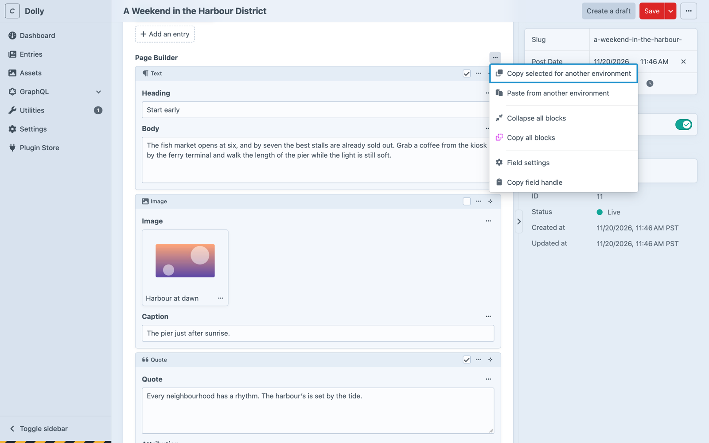
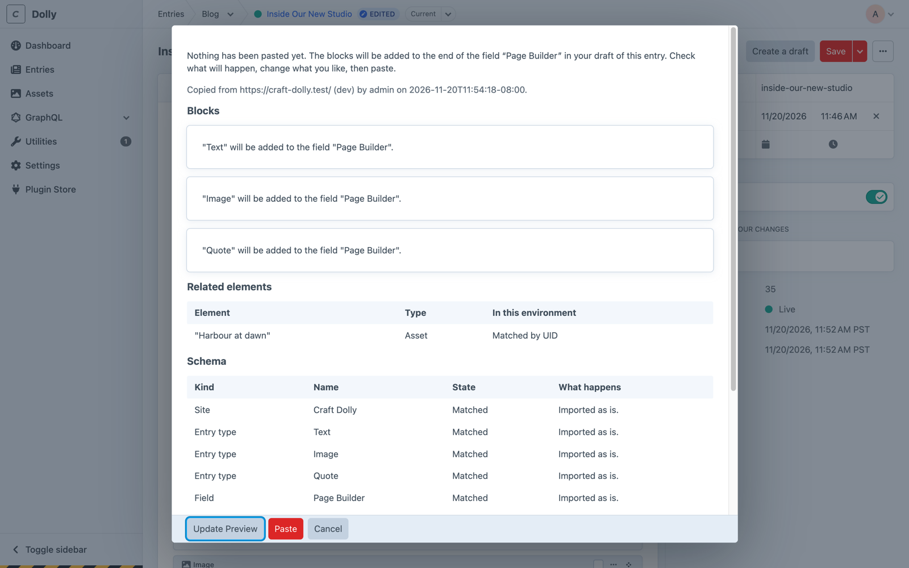

# Copy and paste Matrix and Neo blocks

Block copying and pasting needs Craft 5.7 or later. You need **Export content** to copy and **Import content** to paste.

## Copy blocks

1. Open the entry in the Source environment.
2. Select one or more blocks with their checkboxes.
3. Choose **Copy selected for another environment** in the field’s action menu.

You can also choose **Copy for another environment** in a block’s menu. If that block is selected, Dolly copies every selected block. Dolly checks the page’s block IDs against your draft. If the page is out of date, it refuses the action so you do not copy the wrong block.

You can copy Matrix blocks in cards or inline view, and Neo blocks. A Neo block includes its nested child blocks. The blocks you select are the Payload’s Root elements. Dolly saves unsaved changes to your draft first, then copies the Payload to the clipboard or offers a file, just as it does for an entry.

## Paste blocks

1. Open the entry in the Target environment.
2. Choose **Paste from another environment** in a Matrix or Neo field’s action menu.
3. If Dolly can read a Payload from your clipboard, it opens the Preview straight away. Otherwise, paste the text or upload a `.dolly` file in the modal.
4. Review the blocks, warnings and choices for related content, then click **Paste**.
5. Save or apply your draft as usual.

Dolly adds the blocks to the end of the field in your draft. It creates a provisional draft if you do not have one. The live entry stays as it is. The paste is recorded in the [Import log](import-log.md#check-the-import-log), Dolly’s permanent record of Imports.

**Opening the Preview saves what is on screen to your draft first, even if you cancel.** This can create a provisional draft. Craft’s own “add block” action works this way too. Dolly needs the draft’s current blocks and sites to build an accurate Preview.

Only the draft’s own site is written, as in Craft’s editor. Craft propagates blocks to other sites according to the field’s propagation method. Dolly never saves a site you cannot edit. If you paste more than the field’s maximum number of blocks, the Preview warns you. The draft still saves; Craft checks the maximum when you apply the draft.

## Which fields accept the blocks?

| Payload | Where you can paste it |
| --- | --- |
| Matrix blocks | Any Matrix field that allows their entry types. Blocks of other types are skipped with a warning. |
| Neo blocks | The same Neo field they came from, matched by UID (Craft’s unique identifier). Its block types and hierarchy belong to that field. Another Neo field refuses the Payload with a message. |

The utility and `dolly/import` accept entry Payloads, not block Payloads. A field accepts block Payloads, not entry Payloads.
