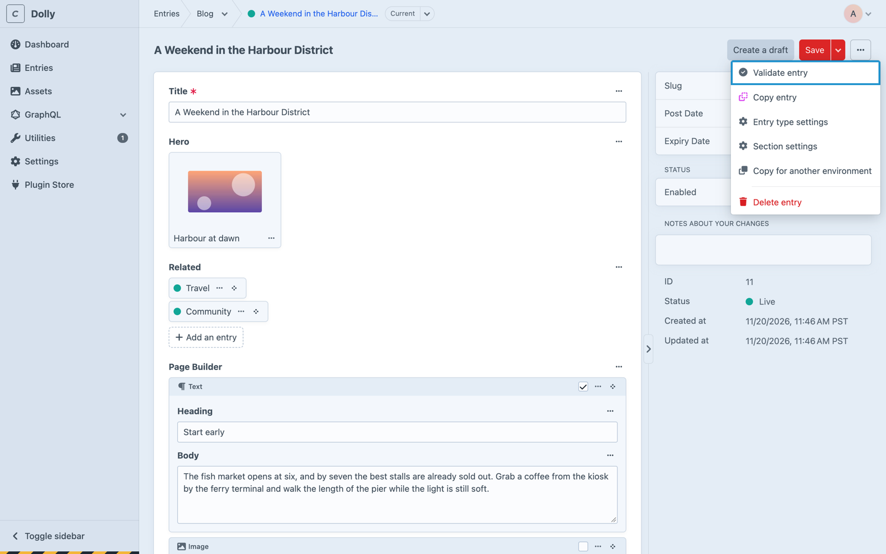
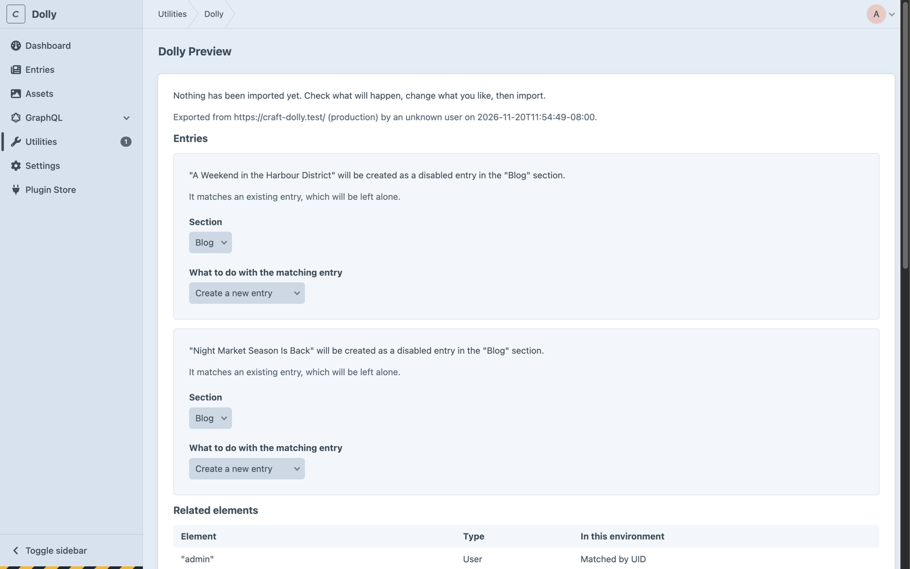

# Copy and import entries

## Copy an entry

You need the **Export content** permission and permission to view the entry.

1. Open the entry in the Source environment.
2. Open the entry editor’s action menu and choose **Copy for another environment**.
3. Wait for the confirmation, then take the Payload to the Target environment.

Dolly exports what you see in the editor. It saves unsaved changes to your draft first, whether you are editing a provisional draft or a named draft. It exports that draft’s content as the entry it belongs to. An unpublished new entry is exported as a new entry. Only sites you can edit are included in the Payload.

You can also select several entries in the entry index and use **Copy for another environment** as a bulk action. This exports the selected canonical entries in one Payload. Each selected entry is a **Root element**: content you explicitly chose to export. Drafts and revisions are not offered in the index.

The action is separate from Craft’s own **Copy** action. Craft’s action is unchanged. You cannot export a revision, a nested entry on its own, or another user’s provisional draft.

### If Dolly offers a file instead

The Payload normally goes to your clipboard. If it is larger than `clipboardLimit` bytes, or your browser blocks copying, the confirmation notice offers a button to download a `.dolly` file instead. You can upload that file in the Dolly utility or a block paste modal.

The default `clipboardLimit` is 100,000 bytes. You can change it in [`config/dolly.php`](configuration.md#config-settings).

## Import entries in the Dolly utility

You need the **Import content** permission and the Craft permissions for the content you will create or edit. See [Permissions](configuration.md#permissions).

1. In the Target environment, go to **Utilities > Dolly**.
2. Paste the Payload into **Payload text**, or upload a `.dolly` file.
3. Click **Preview**.
4. Check the entry choices, related elements and warnings described below.
5. Click **Import**. Dolly opens the Import log entry with the results or queue progress.

New entries arrive **disabled**. If you choose to overwrite a matching entry, Dolly creates a **draft** on it. Review the imported content before you enable an entry or apply a draft.
